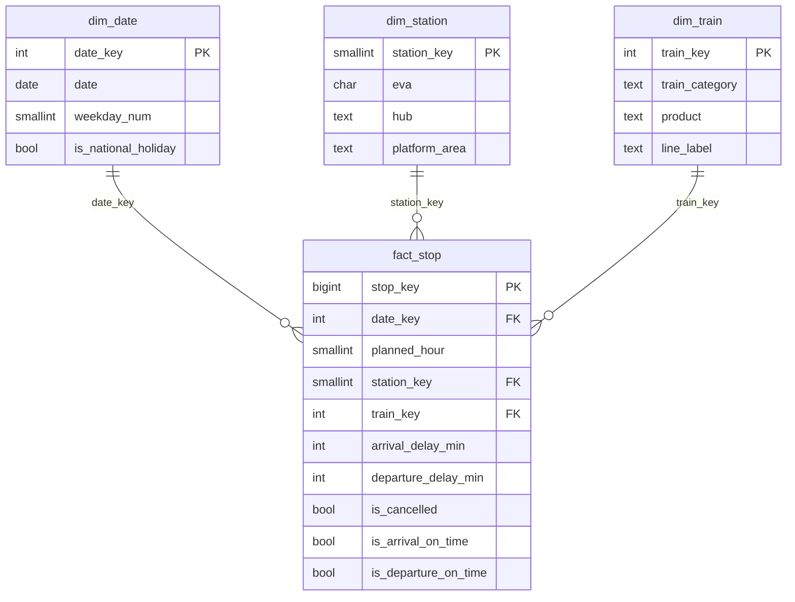

# Data model (PostgreSQL schema `dw`)

DDL: [sql/schema.sql](../sql/schema.sql). Built by `src/transform.py`, loaded by `src/load.py`.

## Grain

`fact_stop`: **one train stop at one hub**. A hub has several EVA numbers (main hall, S-Bahn,
"tief" platforms); a train recorded under more than one of them is kept once.

## Transformation rules

| Rule | Detail | Rows affected (Apr–Sep 2026) |
|---|---|---|
| Drop rows without planned time | No train number, type or delay; cannot be analysed | 24,646 |
| Deduplicate | Key hub + `train_line_ride_id` + planned time (departure, else arrival). Keep: plan record → both arrival and departure → lowest EVA | 858 |
| Delays | `actual − planned` in minutes, per side; NULL if that side is cancelled or absent | — |
| On time | delay < 6 min (`ON_TIME_THRESHOLD_MIN`); early counts as on time | — |
| Implausible | delay > 600 min flagged, on-time flag set to NULL | 6 |
| Service date / hour | From the planned time (departure, else arrival), local time | — |
| Hub holiday | Public holiday in the hub's federal state (`HUB_STATES`, `holidays` package) | 45,911 stops |

`train_line_ride_id` identifies a scheduled run and repeats across days, so the planned time is part of
the dedup key.

## Train categories

`train_type` mixes product and operator codes; the rules live in `config.py`:

| Category | Products | Stops |
|---|---|---|
| `s_bahn` | S (incl. operator SBH) | 830,955 |
| `regional` | RE, RB (product from line prefix for operators such as ME, NX, BRB; FEX/NIRE/HBX → RE) | 551,437 |
| `long_distance` | ICE, IC, EC, ECE, RJ, RJX, NJ, EN, TGV, EUR, ES, FLX, WB, D, UEX | 276,764 |
| `bus` | Bus / rail replacement (Bus, SEV, EV, …) | 7,267 |
| `other` | Charter and special trains (GV, DZ, MSM, …) | 588 |

## Time zone

All timestamps are naive Europe/Berlin local time, as in the source. The data range (Apr–Sep 2026)
contains no DST change.
